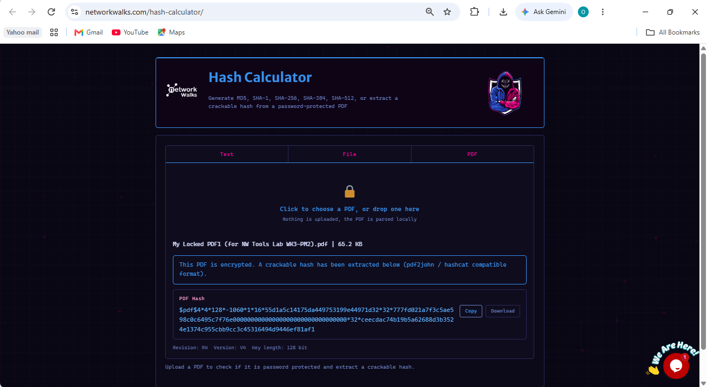
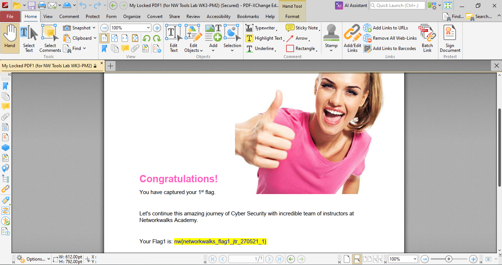
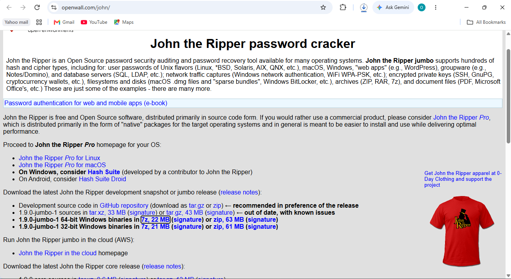
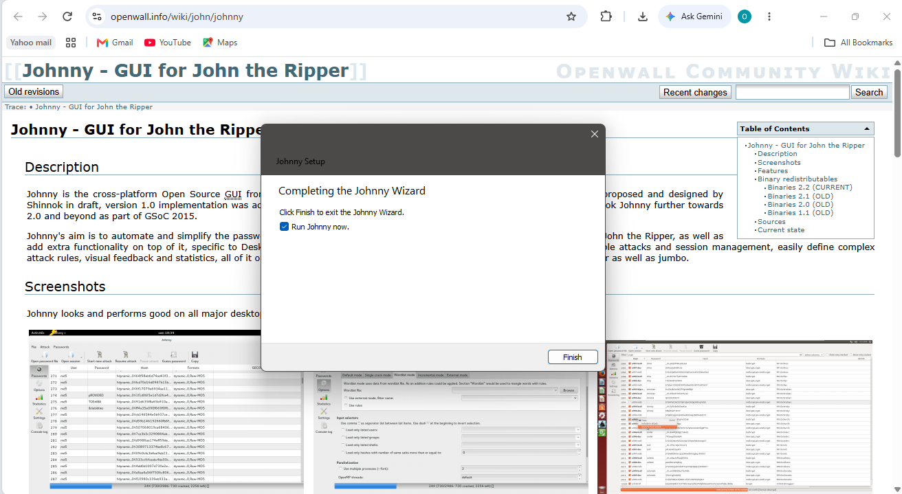
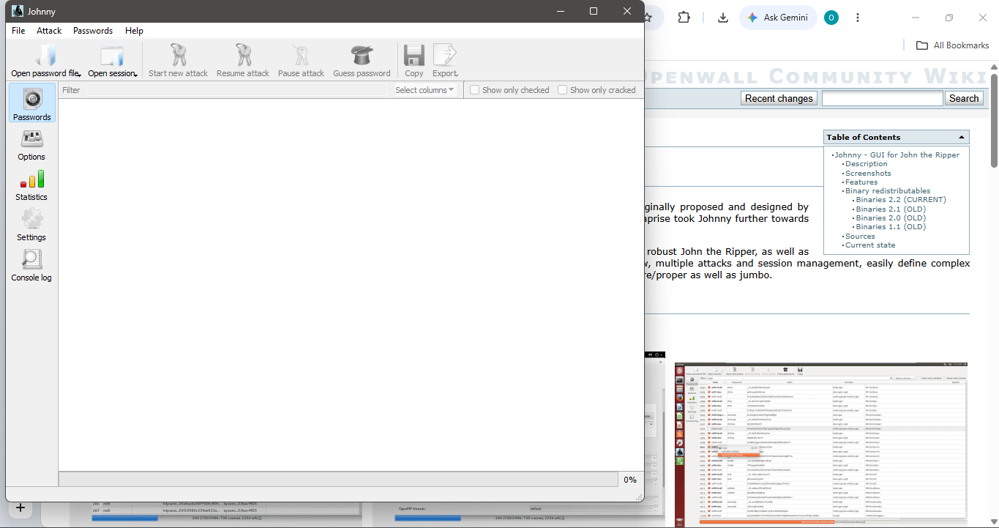
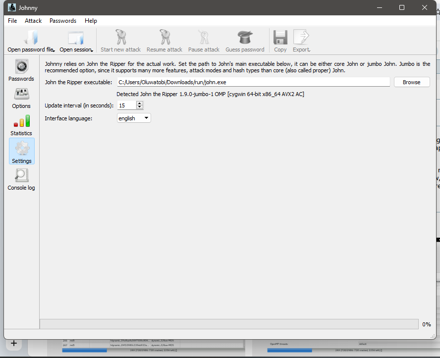
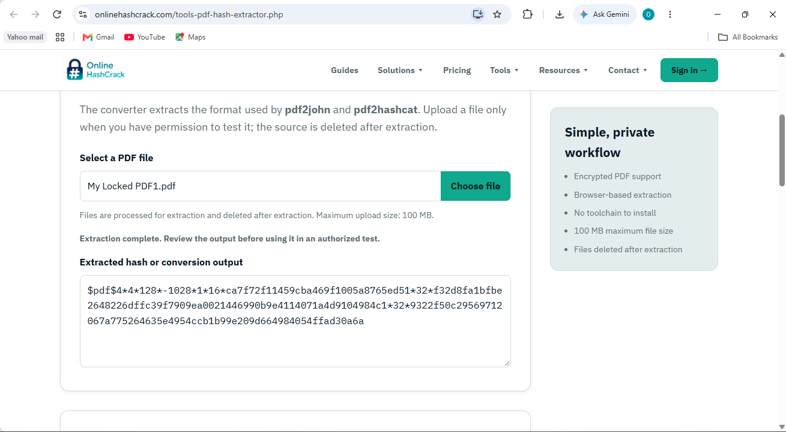
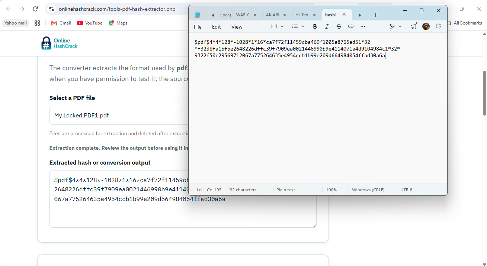
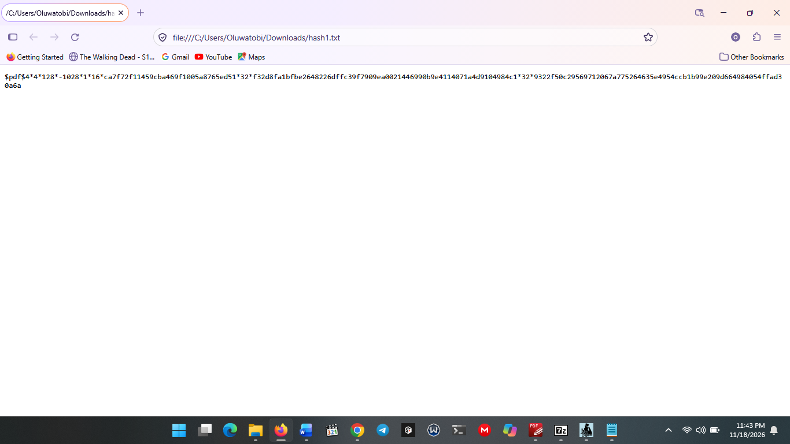
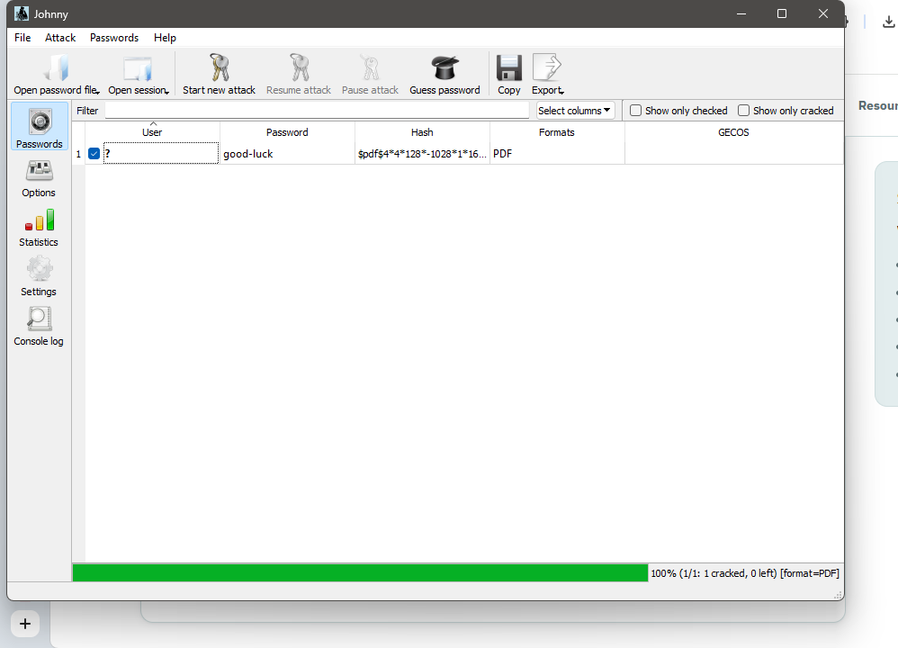

# PASSWORD CRACKING REPORT

**John the Ripper (JTR) and Networkwalks Online Tools**

W3-PM-FINAL | CYBERSECURITY | NETWORKWALKS

| Field | Detail |
|---|---|
| Pentester Name (Cybersecurity Intern) | Oluwatobi Jeremiah Osunseyi |
| Program / Batch | B084 - Networkwalks Cybersecurity Internship |
| Date | 18 November 2026 (all activities carried out on this date) |
| Modules completed | W3-PM1 (Password Cracking with JTR and Johnny); W3-PM2 (Password Cracking with Networkwalks Hash Calculator and Password Cracker) |
| Target files | My Locked PDF1 (for NW Tools Lab WK3-PM2).pdf (used in PM2); My Locked PDF1.pdf (used in PM1) |
| Source of target files | Supplied by Networkwalks as part of the Week 3 project lab, for training purposes. No third-party file or system was tested |
| Flags captured | PM2: nw{networkwalks_flag1_jtr_270521_1}; PM1: nw{cybersecurity_flag_captured_2608} |

## 1. Liability Disclaimer

All activities in this report were carried out against password-protected PDF files supplied by Networkwalks specifically for this training lab. No password cracking was attempted against any file, account or system belonging to a third party. The work was done for education as part of the Networkwalks Cybersecurity Internship, to understand how password hashes are extracted and cracked and why weak passwords are a security risk.

## 2. Introduction

This report documents Week 3 of the internship, which covers both required project modules: W3-PM1 (password cracking with John the Ripper and its graphical front end, Johnny) and W3-PM2 (password cracking with two free browser-based tools built by Networkwalks: the Hash Calculator and the Password Cracker). Both modules use the same underlying idea: extract the password hash stored inside an encrypted PDF, then run that hash through a tool that tries candidate passwords from a wordlist until one matches.

A hash is a one-way scrambled representation of a password; encryption, by contrast, is a two-way function that can be reversed with the right key. Password cracking does not reverse a hash directly. Instead, it hashes each candidate password from a wordlist with the same algorithm the file used, and compares the result to the stored hash. A short or common password is found quickly because it appears early in a wordlist; a long, random password resists this approach because there are too many candidates to try.

Environment used: Johnny (John the Ripper GUI) 2.2, backed by John the Ripper 1.9.0-jumbo-1 (Cygwin 64-bit, x86_64 AVX2), both installed on a Windows laptop; the Networkwalks Hash Calculator and Password Cracker, used directly in a web browser with no installation; and a third-party PDF hash extractor (onlinehashcrack.com) used only for PM1, as specified by the lab guide, to convert the PDF into the pdf2john/hashcat-compatible hash format John the Ripper needs.

## 3. Tools Used

| Tool | Version / where used | Purpose |
|---|---|---|
| Networkwalks Hash Calculator | networkwalks.com/hash-calculator/, PM2 | Extracts a crackable hash ($pdf$...) from a password-protected PDF, entirely in the browser |
| Networkwalks Password Cracker | networkwalks.com/password-cracker/, PM2 | Dictionary attack against a pasted $pdf$ hash, using a built-in 100-password list |
| John the Ripper (JTR) | 1.9.0-jumbo-1, 64-bit Windows (Cygwin build), PM1 | Command-line password cracking engine that performs the actual attack |
| Johnny | 2.2, PM1 | Graphical front end for John the Ripper; loads the hash file and runs the attack with point-and-click controls |
| Online PDF hash extractor | onlinehashcrack.com/tools-pdf-hash-extractor.php, PM1 | Converts the locked PDF into the pdf2john / hashcat-compatible hash format John the Ripper reads |
| Notepad | Windows, PM1 | Used to save the extracted hash as a plain-text file (hash1.txt) for Johnny to open |
| PDF-XChange Editor | Windows | Used to open the cracked PDFs with the recovered passwords and view the captured flags |

## 4. Activities Performed

### 4.1 W3-PM2: Password Cracking with Networkwalks Tools

Target file: My Locked PDF1 (for NW Tools Lab WK3-PM2).pdf, 65.2 KB, supplied by Networkwalks for this lab.

#### Step 1: Extract the hash

The locked PDF was uploaded to the Networkwalks Hash Calculator (PDF tab). The tool parsed the file locally in the browser (no file was uploaded to a server) and returned a crackable hash in pdf2john/hashcat-compatible format:

```
$pdf$4*4*128*-1060*1*16*55d1a5c14175da449753199e44971d32*32*777fd021a7f3c5ae598c0c6495c7f76e00000000000000000000000000000000*32*ceecdac74b19b5a62688d3b3524e1374c955cbb9cc3c45316494d9446ef81af1
```



*Networkwalks Hash Calculator: hash extracted from the PM2 locked PDF*
#### Step 2: Run the dictionary attack

The hash was pasted into the Networkwalks Password Cracker and run against the tool's built-in 100-password list.

| Item | Result |
|---|---|
| Attack type | Dictionary attack (built-in list, 100 passwords) |
| Passwords tried before match | 91 of 100 |
| Cracked password | password1 |



*Password Cracker: 91/100 passwords tried, match found — password1*
#### Step 3: Open the PDF and capture the flag

The PDF was opened and the recovered password, password1, was entered. The file unlocked and revealed the first flag.

| Item | Value |
|---|---|
| Password used | password1 |
| Flag captured | nw{networkwalks_flag1_jtr_270521_1} |

### 4.2 W3-PM1: Password Cracking with JTR and Johnny

Target file: My Locked PDF1.pdf, 267 KB, supplied by Networkwalks for this lab. Task: crack it using John the Ripper (JTR) and its GUI, Johnny, on Windows.

#### Step 1: Install John the Ripper

Downloaded the 1.9.0-jumbo-1 64-bit Windows binaries (7z, 22 MB) from the official site, openwall.com/john, and extracted them to a local folder.



*Official John the Ripper download page (openwall.com/john) with the 64-bit Windows binaries highlighted*
#### Step 2: Install Johnny (GUI)

Downloaded Johnny 2.2 (Windows) from openwall.info/wiki/john/johnny and ran the installer.



*Johnny Setup wizard completing installation*


*Johnny opened for the first time, with no password file loaded yet*
#### Step 3: Point Johnny to the John the Ripper executable

In Johnny's Settings, the John the Ripper executable path was browsed to john.exe inside the extracted run folder. Johnny detected the engine as John the Ripper 1.9.0-jumbo-1 OMP (Cygwin 64-bit, x86_64 AVX2 AC).



*Johnny Settings showing John the Ripper 1.9.0-jumbo-1 detected at C:\Users\Oluwatobi\Downloads\run\john.exe*
#### Step 4: Extract the hash from the locked PDF

John the Ripper itself does not read a PDF directly; the password hash must first be extracted in the pdf2john/hashcat-compatible format. As the lab guide specifies, this was done with a third-party online converter (onlinehashcrack.com), which processes the file for extraction and deletes it afterward.



*Online PDF hash extractor: hash extracted from My Locked PDF1.pdf*
The extracted hash started cleanly with $pdf$, with no stray characters such as a leading b' prefix that the lab guide warns about. It was pasted into Notepad and saved as hash1.txt.



*Hash copied into Notepad before saving as hash1.txt*


*hash1.txt saved at C:\Users\Oluwatobi\Downloads\hash1.txt, opened to confirm its content*
#### Step 5: Load the hash and run the attack in Johnny

hash1.txt was opened in Johnny via Open password file (PASSWD format). Johnny listed one entry with format PDF, and Start new attack was used to begin the crack using John the Ripper's default wordlist mode.

| Item | Result |
|---|---|
| Attack type | John the Ripper default/wordlist mode (via Johnny) |
| Progress at completion | 100% (1/1: 1 cracked, 0 left) |
| Cracked password | good-luck |



*Johnny: attack complete, 1/1 cracked — password good-luck*
#### Step 6: Open the PDF and capture the flag

The PDF was opened and the password good-luck was entered. The file unlocked and revealed the second flag.


*My Locked PDF1.pdf unlocked with password good-luck, showing the captured flag*
| Item | Value |
|---|---|
| Password used | good-luck |
| Flag captured | nw{cybersecurity_flag_captured_2608} |

## 5. Comparison of the Two Approaches

| Aspect | W3-PM2 (Networkwalks tools) | W3-PM1 (JTR + Johnny) |
|---|---|---|
| Setup required | None; both tools run in the browser | Download and install John the Ripper and Johnny; locate john.exe and configure Johnny to use it |
| Hash extraction | Built into the Hash Calculator; done entirely client-side in the browser | Needed a separate online extractor, since neither JTR nor Johnny extracts the hash from a PDF by itself |
| Wordlist used | Built-in list of 100 common passwords | John the Ripper's own default wordlist mode |
| Password found | password1 (a common, weak password) | good-luck (a short dictionary-style password) |
| Time to crack | A few seconds (91 of 100 words tried) | Well under a minute |
| Best suited for | A quick check or a classroom demonstration, no installation needed | Real security testing work, where more hash types, rule-based attacks and larger wordlists are needed |

## 6. Risk Analysis / Impact

These findings are about the sample files used in this lab, not about a production system, and they illustrate a general password-security point rather than a vulnerability in Networkwalks' own infrastructure.

| # | Finding | Evidence | Why it matters | Severity |
|---|---|---|---|---|
| 1 | Both test passwords were cracked almost immediately | password1 matched at 91/100 of a 100-word list; good-luck matched within seconds using a default wordlist | Short, common or dictionary-style passwords offer almost no protection once an attacker has the password hash | High (as a lesson; these were intentionally weak demo passwords, not a live system) |
| 2 | PDF password protection relies entirely on the password's strength | The same $pdf$ hash format was crackable by two completely different tools within seconds | A PDF's encryption algorithm itself is not the weak point; the password chosen by the user is | Informational |
| 3 | Hash extraction tools need no special access to crack a password-protected PDF | Both the Hash Calculator and the online extractor only needed the file itself, no credentials | Anyone who obtains a copy of a protected file can attempt to crack its password offline, without alerting its owner | Informational |

## 7. Recommendations

1. **Use long, random passwords for any protected file.** A 12+ character password mixing upper and lower case, numbers and symbols resists dictionary and wordlist attacks far better than a single common word.
2. **Avoid dictionary words and predictable patterns,** such as password1, good-luck, or anything that would appear in a common wordlist.
3. **Treat a password-protected file as only one layer of protection.** For sensitive documents, combine a strong password with secure storage and, where possible, encryption of the whole disk or folder rather than relying on the file's own password alone.
4. **Only crack passwords you are authorized to test.** Both files used in this lab were provided by Networkwalks for training; the same tools and techniques must never be used against a file or account without the owner's permission.

## 8. Notes and Limitations

- Both target PDFs were supplied by Networkwalks specifically for this exercise; no third-party file or system was involved.
- PM1 required a separate online tool to extract the PDF hash, because John the Ripper and Johnny do not parse PDF files directly; this matches the lab guide's own instructions.
- Only the built-in / default wordlists supplied by each tool were used. A custom wordlist was not tested, so these results show how quickly a password is found against a modest list, not the absolute limit of either tool.
- The two optional Week 3 modules (an AI-assisted JTR lab requiring an MCP server set up in Claude Desktop, and a separate "Mediroza Hospital patient portal" exercise) were not attempted, as they are optional and outside this report's scope.

## 9. Conclusion

Both required Week 3 modules were completed successfully. W3-PM2 showed how Networkwalks' own browser-based tools can extract a hash and crack a weak PDF password in seconds with no installation at all. W3-PM1 showed the same underlying attack using the industry-standard tool, John the Ripper, through its graphical front end, Johnny, which needed more setup but reflects how password auditing is done in real security work.

The clearest lesson from both modules is that password strength, not the encryption algorithm, is what actually protects a file. Both sample passwords, password1 and good-luck, were cracked almost instantly because they are short, common, or dictionary words. This is the same reason strong, unpredictable passwords matter for any account or protected file in real use.

## 10. Evidences Collected

All screenshots are in the [screenshots](screenshots) folder and are shown inline in section 4.
